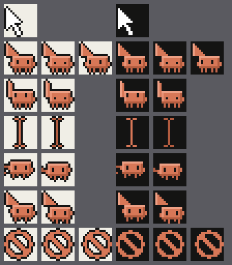

# Clawd Pet

Um pet de desktop do Clawd, o mascote do Claude Code. Ele vive em cenários de ASCII art, sai em missões, traz curiosidades num bloco de notas e reage ao mouse.

Criado por **Rodrigo Graça** · [GitHub](https://github.com/LastHasagi) · [LinkedIn](https://www.linkedin.com/in/rodrigo-de-souza-graca/)


**Cuidado com o seu mouse (Windows):** se o ponteiro ficar parado perto dele, o Clawd pode engolir o ponteiro e cuspir o dele, com um cursor animado para cada ação (seta, link, texto, ocupado, carregando, proibido). Para pegar o seu de volta, clique nele (ou use "Devolver meu cursor" na bandeja). Ele também devolve sozinho depois de 10 minutos e sempre que o app fecha.



**Ele come ícones (Windows):** arraste arquivos ou pastas da área de trabalho até o Clawd e ele engole tudo. Nada é apagado nem movido: os itens só ficam ocultos, e ele devolve quando você clica nele, pela bandeja, depois de 5 minutos ou quando o app fecha.

**Instalar:** baixe o instalador da sua plataforma em [Releases](https://github.com/LastHasagi/claude-wallpaper/releases) (Windows `.exe`/`.msi`, macOS `.dmg`, Linux `.AppImage`/`.deb`/`.rpm`). Os instaladores não são assinados. No Windows, o SmartScreen pode avisar: "Mais informações" → "Executar assim mesmo". No macOS, na primeira vez, clique com o botão direito no app → Abrir.

## Rodando

```bash
npm install
npm run dev          # http://localhost:5173
npm test             # testes unitários e de integração (Vitest)
npm run typecheck
npm run build        # gera dist/ (o que o app desktop embute)
npm run e2e          # build de produção + Edge/Chrome: matriz de missões, clique e teste de resistência
```

### Parâmetros de URL (desenvolvimento)

| Parâmetro | Efeito |
|---|---|
| `mode=overlay` | Modo pet solto: fundo transparente (no navegador aparece um desktop falso) |
| `mission=birdwatching\|coding\|reading-bench` | Começa direto nessa missão |
| `theme=dark\|light`, `lang=pt\|en`, `size=S\|M\|L`, `fps=15\|30\|60` | Sobrescrevem as configurações |
| `freq=often\|normal\|rare`, `notes=off\|sometimes\|always` | Frequência das missões e das curiosidades |
| `cursor=off\|sometimes\|often` | Com que frequência ele rouba o ponteiro (no navegador, só o ponteiro da página muda) |
| `speed=N` | Acelera o tempo |
| `hour=H` | Força o horário (dia, entardecer, noite) |
| `seed=S` | Cenários e sorteios reproduzíveis |
| `debug=1` | Painel com FPS, tempos e estados. Teclas: **M** missão, **N** bilhete, **T** tema, **L** idioma, **C** rouba/devolve o ponteiro, **B** come/cospe ícones de mentira |

## App desktop (Tauri)

```bash
npm run tauri dev     # app com recarga a quente (precisa do Rust instalado)
npm run tauri build   # instaladores em src-tauri/target/release/bundle/ (NSIS .exe e .msi no Windows)
npm run icon          # regenera os ícones a partir do sprite do Clawd
```

Na primeira execução aparece a tela de boas-vindas para escolher o modo. Depois disso, tudo fica no ícone da bandeja (mostrar/esconder, modos, configurações e sair).

| Modo | Como funciona |
|---|---|
| **Pet solto** | Janela transparente do tamanho da área de trabalho, sempre por cima. Os cliques atravessam, exceto sobre o Clawd e o bilhete (o cursor é consultado ~30 vezes por segundo). |
| **Terrário** | Janela pequena sem bordas. Arraste pela faixa do topo, onde fica a ⚙ para as configurações. Posição e tamanho são salvos. |
| **Papel de parede** | **Windows:** anexada atrás dos ícones (técnica WorkerW, compatível com o layout do Windows 11 24H2+). Com mais de um monitor, o app pergunta onde aplicar: em um monitor ou em **todos**. Em todos, cada monitor tem o próprio cenário e o próprio chão, e o Clawd passeia de um para o outro. **macOS/Linux:** tela cheia "sempre por baixo" (alternativa, ainda não testada nesses sistemas). |

Linha de comando: `clawd-pet --mode overlay|terrarium|wallpaper`. Com o app já aberto, isso só troca o modo da instância em execução. `clawd-pet --cursor steal|return` pede ao Clawd que roube o ponteiro ou o devolva. `clawd-pet --restore-all` devolve tudo o que ele está segurando (ícones e ponteiro); o desinstalador usa isso antes de remover o app.

**O cursor do Clawd (Windows):** os arquivos `.ani` são gerados pelo motor a partir da arte em pixel (16×16, em 32/48/64/96 px para cada escala de tela) e ficam em `%LOCALAPPDATA%\dev.clawdpet.app\cursors\`. A troca usa `SetSystemCursor`; a devolução recarrega o esquema de ponteiros do próprio usuário (`SPI_SETCURSORS`), então nada dele é sobrescrito. Um marcador lembra a troca: se o app cair, o ponteiro original volta na próxima abertura (ou no logoff). No papel de parede, ele só rouba quando o ponteiro está sobre a área de trabalho. macOS e Linux não permitem trocar o ponteiro do sistema, então lá a opção não aparece. `node scripts/cursor-sheet.mjs` desenha todos os quadros num PNG.

**A barriga do Clawd (Windows):** itens soltos sobre ele passam pelo `belly.rs`. Ele só aceita o que está direto na Área de Trabalho do usuário (a pasta conhecida, que segue o OneDrive) e recusa links, itens de sistema e itens já ocultos. Comer liga só o atributo *oculto*; nada é movido, apagado ou alterado. A lista fica em `%LOCALAPPDATA%\dev.clawdpet.app\belly.json` e é gravada antes de ocultar. Tudo volta ao sair, ao abrir (depois de uma queda), ao recriar a janela, pela bandeja, depois de 5 minutos e na desinstalação (gancho NSIS em `src-tauri/windows/hooks.nsh`). Na hora de soltar, o WebView responde "copiar" ao Explorer, nunca "mover".

O config do app fica em `%APPDATA%\dev.clawdpet.app\config.json` (Windows). As preferências do motor ficam no armazenamento local do WebView.

### Publicando uma versão

Releases são automáticas (`.github/workflows/release.yml`):

1. Suba a `version` em `src-tauri/tauri.conf.json` e no `package.json`.
2. Escreva em [CHANGELOG.md](CHANGELOG.md) uma seção `## vX.Y.Z` com o que mudou. Ela vira o texto da release (`node scripts/release-notes.mjs vX.Y.Z` mostra como vai ficar).
3. Faça commit e depois `git tag v0.2.0 && git push origin v0.2.0`.

O GitHub Actions roda os testes, confere se a tag bate com a versão do app e se o CHANGELOG tem a seção dela, compila Windows, macOS (universal) e Linux e publica a release com os instaladores. Em todo push e pull request, o `ci.yml` roda o typecheck e os testes.

**Atualizações:** o app consulta as Releases do GitHub ao abrir e a cada 6 horas. Quando sai uma versão nova, aparece um item na bandeja, um banner nas configurações e o Clawd traz um bilhete avisando. Dá para desligar em Configurações → "Avisar sobre novas versões". Nenhum outro dado é enviado.

**Limitações conhecidas:** o pet solto e o terrário usam o monitor principal; no modo papel de parede o Clawd não recebe cliques (quem recebe é a área de trabalho), mas os olhos seguem o cursor e ele acena; com a barra de tarefas em ocultar automaticamente, o pet solto anda rente à borda inferior.

## Arquitetura

Organizada por feature, com MVC dentro de cada uma. As features só conversam pelo `index.ts` umas das outras ou pelo `EventBus`, e um teste de arquitetura (`tests/architecture.test.ts`) garante isso.

```
src/
  app/        composição (bootstrap), game loop com passo fixo, debug
  shared/     rng, eventos, i18n, hora do dia, render (AsciiGrid, CanvasBackend, sprites, paletas)
  host/       HostAdapter (o contrato com quem embute o motor), BrowserHost, TauriHost, arquivos .cur/.ani
  features/
    clawd/     personagem: sprites montados por partes, fila de ações, cérebro (reações + vida própria)
    scene/     biomas ASCII (montanhas, parque, quarto), céu por horário, props, efeitos, transições
    missions/  diretor de missões, contexto com cancelamento, terminal, catálogo das missões
    notes/     curiosidades PT/EN, sorteio sem repetição, entrega e dispensa do bilhete
    cursor/    o Clawd engole o ponteiro e cospe o dele: regras, cena, arte dos cursores
    belly/     ícones arrastados até ele: fome, cena de comer/recusar/cuspir, digestão
    settings/  preferências validadas e persistidas
```

Duas camadas de canvas: o fundo ASCII só redesenha as células que mudaram (normalmente dezenas por frame), e a frente (sprites e interface) é redesenhada a cada frame. Em 1080p o render fica abaixo de 1 ms por frame.

Documentos: [spec](docs/superpowers/specs/2026-10-30-clawd-engine-design.md) · [plano](docs/superpowers/plans/2026-10-30-clawd-engine.md)

## Licença

[PolyForm Noncommercial 1.0.0](LICENSE). Na prática:

- ✅ pode ler, usar, modificar e compartilhar para fins **não comerciais** (uso pessoal, estudo, pesquisa, organizações sem fins lucrativos);
- ✅ **crédito obrigatório**: toda cópia ou derivado precisa manter as linhas `Required Notice` do [LICENSE](LICENSE) (autor e links);
- ❌ **uso comercial** (vender, embutir em produto pago etc.) só com autorização do autor.

Claude, Claude Code e o Clawd são marcas da Anthropic. Este projeto não é afiliado nem endossado pela Anthropic.
